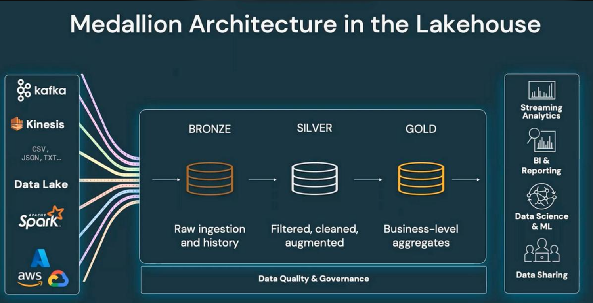

# Databricks Medallion Architecture – Customer Data Pipeline

## Project Overview

An end-to-end customer data engineering project built using Databricks Free Edition, PySpark, and Delta Lake, following Medallion Architecture.

The project demonstrates raw data ingestion, data cleaning, incremental loading, business aggregations, data quality validation, and pipeline audit logging.

## Technology Stack

- Databricks Free Edition
- PySpark
- Python
- Spark SQL
- Delta Lake
- Databricks Jobs and Workflows
- Medallion Architecture

## Architecture

Source Data → Bronze → Silver → Gold → Analytics

## Project Notebooks

| Notebook | Description |
|---|---|
| 01_Bronze_Customer_Ingestion | Raw customer data ingestion |
| 02_Silver_Customer_Transformation | Data cleaning and deduplication |
| 03_Gold_Customer_Analytics | City-wise customer aggregation |
| 04_Incremental_Load_Merge | Incremental insert and update using MERGE |
| 05_Data_Quality_Checks | Duplicate and mandatory-field validation |
| 06_Pipeline_Audit_Log | Pipeline status and row-count logging |

## Medallion Layers

### Bronze Layer
- Ingested raw customer records.
- Added ingestion timestamp.
- Stored data in Delta format.

### Silver Layer
- Handled missing email values.
- Removed duplicate customer records.
- Applied data validation.
- Implemented incremental MERGE operations.

### Gold Layer
- Performed city-wise aggregations.
- Calculated total customers.
- Calculated customers with missing email addresses.

## Incremental Loading

Implemented Delta Lake MERGE to:
- Update existing customer records.
- Insert new customer records.
- Avoid reloading the complete Silver table.

## Data Quality and Audit

- Duplicate customer ID validation.
- Mandatory field validation.
- Pipeline execution status logging.
- Row counts and execution timestamps.

## Project Results

- 6 customer records in Silver.
- 5 city summary records in Gold.
- Incremental update and insert tested successfully.
- Data quality checks passed.
- Pipeline audit status: SUCCESS.

## Key Learnings

- PySpark transformations.
- Delta Lake MERGE operations.
- Incremental data processing.
- Window functions and deduplication.
- Databricks Jobs orchestration.
- Data quality and audit logging.

## Disclaimer

This is a personal learning and portfolio project using synthetic customer data in Databricks Free Edition. It is not a production deployment.
